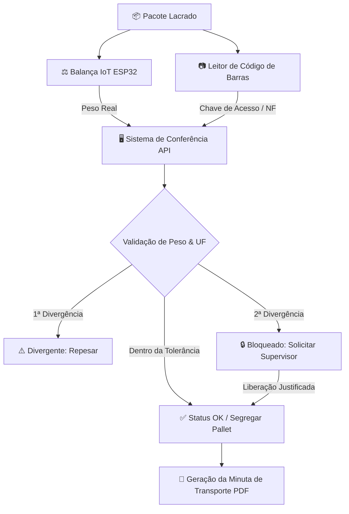

# 📦 Sistema de Expedição e Conferência Final — Euroart

<div align="center">


<p align="center">
  <b>Projeto Integrador (PI) — Análise e Desenvolvimento de Sistemas (ADS)</b><br>
  <b>Faculdade de Tecnologia de Indaiatuba (FATEC Indaiatuba)</b> em parceria com a <b>Euroart</b>
</p>

</div>

---

## 📑 Sumário

- [Sobre o Projeto](#-sobre-o-projeto)
- [Objetivo e Contexto de Negócio](#-objetivo-e-contexto-de-negócio)
- [Principais Funcionalidades](#-principais-funcionalidades)
- [Arquitetura e Fluxo Logístico](#-arquitetura-e-fluxo-logístico)
- [Tecnologias Utilizadas](#-tecnologias-utilizadas)
- [Estrutura do Repositório](#-estrutura-do-repositório)
- [Pré-requisitos](#-pré-requisitos)
- [Instalação e Execução](#-instalação-e-execução)
- [Configuração de Variáveis de Ambiente](#-configuração-de-variáveis-de-ambiente)
- [Migrations e Banco de Dados](#-migrations-e-banco-de-dados)
- [Visão Geral da API REST](#-visão-geral-da-api-rest)
- [Integração de Hardware (IoT)](#-integração-de-hardware-iot)
- [Documentações Complementares](#-documentações-complementares)
- [Autores e Agradecimentos](#-autores-e-agradecimentos)
- [Licença](#-licença)

---

## 📖 Sobre o Projeto

O **Sistema de Expedição e Conferência Final Euroart** é uma solução completa desenvolvida para atuar como barreira de segurança logística após o processo de empacotamento. Ele valida a integridade de cada pacote expedido cruzando a leitura de código de barras/QR Code das Notas Fiscais com o peso aferido em tempo real por uma balança inteligente integrada via microcontrolador ESP32.

O sistema simula a conferência rígida realizada pelos centros de distribuição (CDs) dos maiores marketplaces (Mercado Livre, Amazon, Shopee), mitigando erros de envio, extravios, fraudes e retrabalhos operacionais.

---

## 🎯 Objetivo e Contexto de Negócio

No fluxo convencional de faturamento e separação, após a caixa ser lacrada não existia uma checagem sistêmica automatizada além do romaneio manual. O sistema preenche essa lacuna:

1. **Recepção de Lote Fiscal:** Importação de remessas consolidadas em JSON a partir das NF-es faturadas.
2. **Conferência em Gesto Único:** O operador posiciona a caixa na balança e bipa a chave de acesso da DANFE simplificada.
3. **Cálculo Dinâmico de Peso:** Soma da tara da embalagem cadastrada com o peso unitário e quantidade de cada SKU, aplicando a tolerância percentual pré-definida.
4. **Tratamento de Exceções:** Bloqueio de caixas com divergência reincidente (exigindo liberação com senha e justificativa de supervisor) e alertas de anexação obrigatória de Guia de ICMS (GNRE).
5. **Emissão de Minuta de Transporte:** Geração instantânea de romaneio em PDF para assinatura da transportadora e registro de saída.

---

## ✨ Principais Funcionalidades

- [x] **Conferência Bip a Bip com IoT:** Validação simultânea da chave de acesso e do peso lido pelo sensor de carga via ESP32.
- [x] **Importação de Remessas (JSON):** Suporte à inserção modular de lotes de notas fiscais vinculadas a uma conferência e transportadora.
- [x] **Gestão de Tolerância e Pesos:** Cadastro individual de SKUs, tolerâncias em porcentagem e tara das caixas de expedição.
- [x] **Bloqueio Automático e Alçada de Liberação:** Bloqueio de segurança na 2ª tentativa de peso divergente, exigindo credenciais de administrador com auditoria.
- [x] **Alerta Fiscal Inteligente (ICMS/GNRE):** Verificação automática da UF de destino, sinalizando estados que exigem a guia física impressa anexada à caixa.
- [x] **Emissão de Minutas em PDF:** Geração de documento consolidado via PDFKit pronto para impressão e assinatura mútua (expedição e motorista).
- [x] **Trilha de Auditoria Completa:** Registro temporal minucioso (quem bipou, horários, pesagem lida vs. esperada, aprovações manuais e cancelamentos).
- [x] **Controle de Acesso Baseado em Perfis (RBAC):** Autenticação segura via JSON Web Tokens (JWT) e senhas criptografadas com Bcrypt (perfis `operador` e `admin`).

---

## 📐 Arquitetura e Fluxo Logístico



### Regra de Validação de Peso:
$$\text{Peso Esperado} = \text{Tara da Caixa} + \sum (\text{Peso Unitário do SKU} \times \text{Quantidade})$$
$$\text{Margem Mínima} = \text{Peso Esperado} \times (1 - \text{Tolerância})$$
$$\text{Margem Máxima} = \text{Peso Esperado} \times (1 + \text{Tolerância})$$

---

## 🛠️ Tecnologias Utilizadas

### Backend & Core
- **[Node.js](https://nodejs.org/):** Ambiente de execução JavaScript assíncrono (v18+ LTS).
- **[TypeScript](https://www.typescriptlang.org/):** Tipagem estática para robustez, manutenção e segurança de código.
- **[Express 5](https://expressjs.com/):** Framework web para roteamento da API RESTful.
- **[Sequelize 6](https://sequelize.org/):** ORM relacional com suporte a transações, migrações e auditoria.
- **[MySQL 2](https://github.com/sidorares/node-mysql2):** Driver de alta performance para comunicação com o banco relacional MySQL.
- **[PDFKit](https://pdfkit.org/):** Geração dinâmica de documentos PDF para minutas de expedição.
- **[Bcrypt](https://www.npmjs.com/package/bcrypt):** Hash criptográfico para armazenamento seguro de credenciais.
- **[JSON Web Token (JWT)](https://jwt.io/):** Controle de sessão stateless seguro via Bearer Token.

### Hardware & IoT
- **ESP32:** Microcontrolador com Wi-Fi para transmissão em rede local.
- **Módulo HX711:** Conversor Analógico/Digital de 24 bits para balanças.
- **Célula de Carga:** Sensor de pesagem analógico calibrado para a operação.

### Ferramentas de Desenvolvimento
- **[TSX](https://github.com/privatenumber/tsx):** Executor e transpilador em tempo real com hot-reload.
- **[Sequelize-CLI](https://github.com/sequelize/cli):** Automação e versionamento de migrations estruturais.
- **[ESBuild](https://esbuild.github.io/):** Empacotador ultrarrápido para suporte de compilação.

---

## 📁 Estrutura do Repositório

```text
PI_ADS_Fatec_Euroart/
├── config/
│   └── config.js              # Configuração do Sequelize CLI (dev e prod)
├── docs/                      # Documentação completa de negócio e técnica
│   ├── documentacao_DB.md     # Dicionário de dados e justificativas relacionais
│   ├── entrevista.md          # Levantamento de requisitos e entrevista operacional
│   ├── guia_de_deploy_e_producao.md # Passo a passo para implantação com PM2
│   ├── integra_o_hardware_iot_esp32.md # Esquema de pinos e firmware do ESP32
│   ├── README.MD              # Documentação de visão geral
│   ├── referencia_da_api_rest.md # Especificação de rotas e payloads HTTP
│   └── regras_de_negocio_e_fluxo_logistico.md # Fórmulas, máquinas de estado e ICMS
├── migrations/                # Versionamento estrutural das tabelas SQL
│   ├── 20260915010000-create-usuarios.js
│   ├── 20260915010001-create-embalagens.js
│   ├── 20260915010002-create-skus-produtos.js
│   ├── 20260915010003-create-conferencias.js
│   ├── 20260915010004-create-remessas.js
│   ├── 20260915010005-create-pacotes.js
│   ├── 20260915010006-create-itens-pacote.js
│   ├── 20260915010007-create-minutas.js
│   ├── 20261011201111-create-regras-icms.js
│   └── 20261101000002-create-logs-auditoria.js
├── others/                    # Modelagens e diagramas do sistema
│   ├── caso de uso.jpg        # Diagrama de Casos de Uso
│   ├── diagrama de classes.jpg # Diagrama de Classes
│   └── mer.jpg                # Modelo de Entidade e Relacionamento (MER)
├── src/                       # Código-fonte da aplicação
│   ├── config/
│   │   └── database.ts        # Conexão centralizada do Sequelize (com SSL para nuvem)
│   └── ...                    # Controllers, Models, Routes e Services
├── .env.example               # Modelo de variáveis de ambiente
├── package.json               # Dependências e scripts do projeto
├── tsconfig.json              # Configurações do compilador TypeScript
└── README.md                  # Este arquivo
```

---

## 📋 Pré-requisitos

Antes de iniciar, certifique-se de ter instalado no ambiente:

- [Node.js](https://nodejs.org/) (Versão **18.x LTS** ou superior)
- [NPM](https://www.npmjs.com/) ou [Yarn](https://yarnpkg.com/)
- [MySQL Server](https://dev.mysql.com/downloads/mysql/) (Versão **8.0** ou superior) ou instância em nuvem compatível (Aiven, RDS, etc.)
- [Git](https://git-scm.com/)

---

## 🚀 Instalação e Execução

### 1. Clonar o Repositório
```bash
git clone https://github.com/seu-usuario/PI_ADS_Fatec_Euroart.git
cd PI_ADS_Fatec_Euroart
```

### 2. Instalar as Dependências
```bash
npm install
```

### 3. Configurar as Variáveis de Ambiente
Copie o arquivo de exemplo e preencha com as credenciais do seu banco de dados:
```bash
cp .env.example .env
```
Edite o arquivo `.env` com suas configurações locais:
```env
PORT=3000
DB_HOST=127.0.0.1
DB_PORT=3306
DB_USER=root
DB_PASSWORD=sua_senha_aqui
DB_NAME=euroart_conferencia
JWT_SECRET=sua_chave_secreta_jwt_aqui
```

### 4. Executar as Migrations
Crie o banco de dados `euroart_conferencia` no MySQL e execute as migrações:
```bash
npx sequelize-cli db:migrate
```

### 5. Iniciar o Servidor

#### Modo de Desenvolvimento (com recarregamento automático):
```bash
npm run dev
```

#### Modo de Produção (compilar e rodar):
```bash
npm run build
npm start
```

---

## 🔐 Configuração de Variáveis de Ambiente

| Variável | Descrição | Exemplo Padrão |
| :--- | :--- | :--- |
| `PORT` | Porta de escuta da aplicação web | `3000` |
| `DB_HOST` | Endereço do servidor MySQL | `127.0.0.1` |
| `DB_PORT` | Porta do banco de dados | `3306` |
| `DB_USER` | Usuário com permissões no banco | `root` |
| `DB_PASSWORD` | Senha do usuário do banco | `""` |
| `DB_NAME` | Nome do banco de dados relacional | `euroart_conferencia` |
| `DATABASE_URL` | String de conexão para deploy em nuvem (ex: Aiven/Render com SSL) | *(Opcional)* |
| `JWT_SECRET` | Chave privada para assinatura dos tokens JWT | `sua_chave_secreta` |

---

## 🗄️ Migrations e Banco de Dados

O banco de dados relacional foi modelado para garantir integridade referencial estrita e histórico imutável de auditoria.

### Estrutura das Tabelas:
- **`usuarios`**: Gestão de operadores e administradores com senhas hash (Bcrypt).
- **`caixas_embalagens`**: Cadastro de caixas com suas respectivas taras em gramas.
- **`sku_produtos`**: Catálogo de itens com peso unitário e tolerância permitida.
- **`conferencias`**: Sessão de expedição ativa vinculada a uma transportadora.
- **`remessas`**: Lote de Notas Fiscais importadas na sessão.
- **`pacotes`**: Caixas a conferir com status (`pendente`, `ok`, `divergente_peso`, `bloqueado`, `liberado_divergente`).
- **`itens_pacote`**: SKUs e quantidades contidas em cada pacote.
- **`minutas`**: Registro e histórico das minutas de transporte geradas.
- **`regras_icms`**: Mapeamento de UFs que exigem guia física anexada (GNRE).
- **`logs_auditoria`**: Rastreabilidade detalhada de eventos e ações críticas.

Consulte o documento completo em [`docs/documentacao_DB.md`](docs/documentacao_DB.md).

---

## 🔌 Visão Geral da API REST

A API disponibiliza endpoints RESTful protegidos por autenticação JWT:

| Método | Rota | Descrição | Nível de Acesso |
| :--- | :--- | :--- | :--- |
| `POST` | `/api/auth/login` | Autenticação e obtenção do token JWT | Público |
| `GET` | `/api/conferencias/ativas` | Retorna a conferência em andamento e seus pacotes | Operador / Admin |
| `POST` | `/api/conferencias/bipar` | Bipagem do pacote, leitura da tara e validação de peso | Operador / Admin |
| `POST` | `/api/conferencias/pacotes/:id/liberar` | Liberação forçada de pacote divergente com justificativa | Apenas Admin |
| `POST` | `/api/balanca/peso` | Endpoint de recepção do peso enviado pelo ESP32 | Sistema / IoT |

Para consultar exemplos de payloads de requisição e resposta, acesse [`docs/referencia_da_api_rest.md`](docs/referencia_da_api_rest.md).

---

## 📡 Integração de Hardware (IoT)

A comunicação com a balança física utiliza a seguinte arquitetura:

- **Placa Controladora:** ESP32 conectado à rede local via Wi-Fi.
- **Circuito Sensor:** Módulo conversor analógico-digital HX711 acoplado a uma célula de carga.
- **Comunicação:** Ao estabilizar o peso, o ESP32 realiza um push HTTP para a API ou emite via WebSocket.

Pinagem recomendada:
- **DT (Data):** GPIO 21
- **SCK (Clock):** GPIO 22
- **VCC:** 3.3V / **GND:** GND

Mais detalhes sobre calibração e diagrama de circuito em [`docs/integra_o_hardware_iot_esp32.md`](docs/integra_o_hardware_iot_esp32.md).

---

## 📚 Documentações Complementares

Para um aprofundamento técnico e operacional, consulte os guias na pasta `docs/`:

- [Dicionário de Dados e Banco de Dados](docs/documentacao_DB.md)
- [Regras de Negócio e Fluxo Logístico](docs/regras_de_negocio_e_fluxo_logistico.md)
- [Levantamento de Requisitos e Entrevista](docs/entrevista.md)
- [Referência Completa da API REST](docs/referencia_da_api_rest.md)
- [Guia de Deploy e Produção com PM2](docs/guia_de_deploy_e_producao.md)
- [Integração de Hardware IoT ESP32](docs/integra_o_hardware_iot_esp32.md)

---

## 👥 Autores e Agradecimentos

Este projeto foi concebido e implementado pelos estudantes do curso de **Tecnologia em Análise e Desenvolvimento de Sistemas (ADS)** da **FATEC Indaiatuba - Dr. Archimedes Lammoglia**:

- **Equipe de Desenvolvimento:** Projeto Integrador FATEC Indaiatuba
- **Parceiro de Negócio:** Euroart Indústria e Comércio
- **Apoio Técnico e Levantamento:** Felipe Campelo (Euroart) & Davi Françozo (FATEC)

Agradecimentos ao corpo docente da FATEC Indaiatuba e à equipe de logística da Euroart pela disponibilidade e colaboração em todas as etapas de validação em campo.

---

## 📄 Licença

Este projeto é desenvolvido para fins educacionais e de aplicação prática corporativa, sob os termos da licença [ISC](LICENSE).
